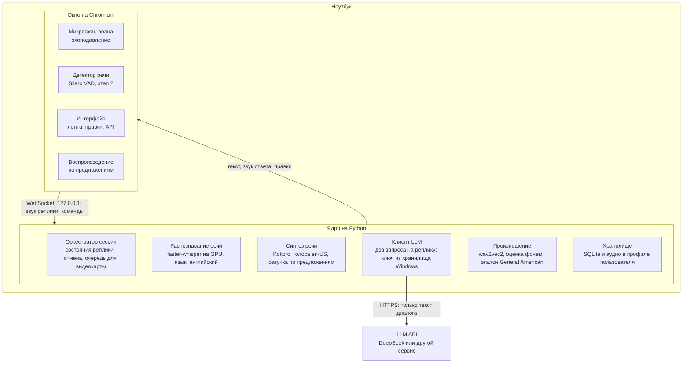
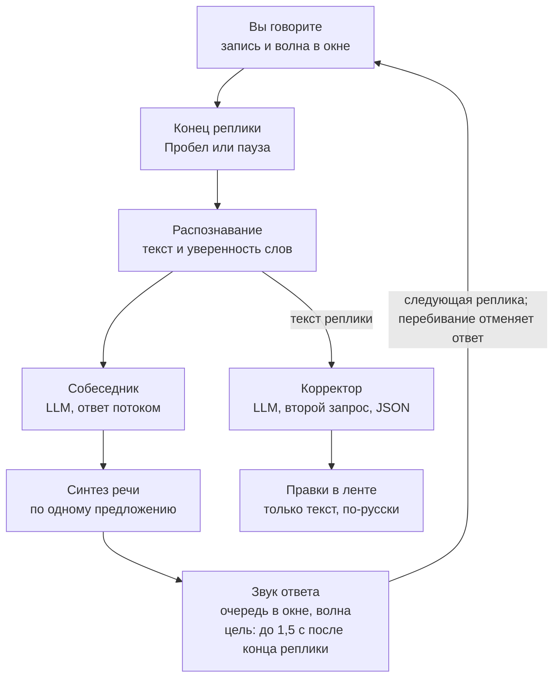

# Голосовой тренажёр американского английского: проект системы

Версия от 11 ноября 2026. Экспорт из документа проекта; диаграммы перерисованы в Mermaid. Статичные макеты экранов лежат в `docs/ui/`, порядок работ и критерии приёмки — в `docs/PLAN.md`.

## Ключевые решения

Строим локальное приложение для Windows: речь распознаётся и синтезируется на ноутбуке, наружу уходит только текст диалога в выбранный LLM API.

| Развилка | Решение | Почему |
| --- | --- | --- |
| Форма приложения | Ядро на Python и окно на Chromium, связь по `127.0.0.1` | В окне Chromium есть готовое эхоподавление и шумоподавление микрофона; модели живут в Python |
| Распознавание речи | Локально на RTX 5060, язык зафиксирован: английский | Звук не покидает ноутбук, задержка — доли секунды |
| Диалог | Любой OpenAI-совместимый API; активное подключение выбирается в таблице | Один протокол покрывает DeepSeek и большинство других провайдеров |
| Ответ и правки | Два независимых запроса на реплику: «собеседник» и «корректор» | Ответ начинает звучать сразу, правки приходят текстом чуть позже и не тормозят разговор |
| Язык | Собеседник говорит только на американском английском; правки и пояснения только на русском и только текстом | Русский не озвучивается, чтобы не ломать погружение |
| Синтез речи | Локально, американские голоса, озвучка по предложениям | Первое предложение звучит, пока модель дописывает остальные |
| Очерёдность реплик | По умолчанию ручная: Пробел начинает и заканчивает реплику; автоопределение паузы — опция | Изучающий язык думает дольше, автоопределение обрывает на полуслове |
| Произношение | Отдельная фонемная модель, эталон — General American; основной режим — чтение заданной фразы | При известном эталоне оценка надёжнее всего |
| Ключи API | В Диспетчере учётных данных Windows; в базе только название, адрес и модель | Ключ не лежит в файлах приложения |
| Данные | SQLite и аудиофайлы в профиле пользователя | Один пользователь, один компьютер |

## Что взято из удачных решений

Архитектура повторяет каскад «детектор речи → распознавание → LLM → синтез», на котором построены открытые голосовые агенты. Интерфейс правок повторяет связку «пометки в реплике, карточка, итог», общую для Loora и Langua.

| Откуда | Приём | Как применяем |
| --- | --- | --- |
| [Loora: правки](https://www.loora.com/support/features/feedback-and-corrections) | Подчёркнутые слова — грамматика, подсвеченные — произношение; по нажатию открывается карточка «было → стало» с правилом и естественным вариантом фразы | Те же два вида пометок в реплике и карточка под ней; текст карточки на русском |
| [Loora: главный вывод](https://www.loora.com/news/product-updates/key-takeaways) | После урока выбирается одна самая важная правка и превращается в короткое упражнение | Экран «Итоги»: один главный вывод с упражнением, остальное списком |
| [Langua: правки](https://languatalk.com/try-langua?via=donovan) | Правки доступны сразу в одно нажатие или отчётом после разговора; стиль правок выбирается | Настройка «Правки: сразу / по нажатию / в конце / выкл.» |
| [Langua: помощь](https://apps.apple.com/app/id6737520234) | Подсказки ответа, мгновенный перевод, настройка скорости реакции тьютора перед звонком | Кнопки «Подсказка» и «Перевод», ползунок допустимой паузы |
| [ELSA Speak](https://blog.elsaspeak.com/en/advantage-of-elsa-feedback) | Цветовая разметка звуков и слов, балл за слово и фразу | Шкала зелёный / жёлтый / красный в режиме произношения |
| [Pipecat Smart Turn](https://docs.pipecat.ai/pipecat-cloud/guides/smart-turn) | Поверх детектора речи работает модель, отличающая конец реплики от паузы на раздумье; ей хватает процессора | Этап 2: подтверждение конца реплики в автоматическом режиме |
| [Курс DeepLearning.AI](https://learn.deeplearning.ai/courses/building-ai-voice-agents-for-production/lesson/fjmwt/end-to-end-architecture---part-2) | Ответ LLM режется на предложения, каждое сразу уходит в синтез; речь пользователя во время ответа отменяет ответ | Озвучка по предложениям и перебивание |
| [RealtimeVoiceChat](https://hn.nuxt.dev/item/43899028), [Vocalis](https://nyc1.lr.ggtyler.dev/r/LocalLLaMA/comments/1jy1x1b/vocalis_local_conversational_ai_assistant_speech) | Локальные связки Whisper, LLM и Kokoro через WebSocket отвечают за 0,5–0,6 с при локальной LLM | Тот же транспорт; цель с облачной LLM — до 1,5 с до первого звука |
| [vad-web](https://docs.vad.ricky0123.com/user-guide/browser/) | Детектор речи Silero работает прямо в окне; микрофон открывается с эхоподавлением, шумоподавлением и автоусилением | Звук захватывается в окне, а не в Python |

## Архитектура

Приложение состоит из двух частей на одном компьютере: окна на Chromium, где живут звук и интерфейс, и ядра на Python, где живут модели и данные.

Звук, записи и ключи остаются на ноутбуке.

Окно и ядро общаются по WebSocket внутри ноутбука; единственная стрелка наружу — запросы клиента LLM к выбранному API.

| Компонент | Технология | Примечание |
| --- | --- | --- |
| Окно | Edge в [режиме приложения](https://tldr.dendron.so/notes/windows.msedge.html) `--app` с отдельным каталогом профиля | Нет адресной строки и расширений; профиль хранит разрешение на микрофон |
| Захват звука и волна | `getUserMedia` и Web Audio | Эхоподавление и шумоподавление браузера; волна рисуется всё время, пока открыт микрофон |
| Детектор речи | Silero VAD через [vad-web](https://docs.vad.ricky0123.com/user-guide/browser/) | Файлы модели раздаёт ядро, внешних загрузок нет |
| Ядро | Python, FastAPI, один процесс | HTTP для настроек и истории, WebSocket для разговора |
| Распознавание | [faster-whisper](https://pypi.org/project/faster-whisper), модель `turbo`, `float16` | Язык зафиксирован, слова возвращаются с таймингами |
| Синтез | [Kokoro](https://github.com/hexgrad/kokoro), `lang_code='a'` | Американские голоса `af_*` и `am_*`, 24 кГц, параметр скорости; нужен espeak-ng |
| Произношение | wav2vec2-lv-60-espeak-cv-ft | Загружается при входе в режим «Чтение» |
| Конец реплики | Smart Turn v3, ONNX на процессоре | Этап 2 |
| Хранилище | SQLite и файлы аудио | Одна папка в профиле |

Почему окно на Chromium, а не звук через Python: браузерный захват сразу даёт эхоподавление, без которого ответ из динамиков попадает обратно в микрофон. Встроенный WebView2 оставлен на потом: в нём разрешение на микрофон нужно обрабатывать отдельно.

По оценке, три модели вместе занимают 5–6,5 ГБ из 8 ГБ видеопамяти. Запас дают перенос Kokoro на процессор и загрузка фонемной модели по требованию; точные цифры даст этап 0.

## Поток реплики и протокол

После распознавания реплика уходит в два независимых запроса: один даёт озвученный ответ, второй — текстовые правки.

Верхняя ветка определяет задержку разговора, нижняя на неё не влияет: правки появляются в ленте, когда готовы.

Правила потока:

- Реплика уходит в ядро целиком после её конца. Потоковое распознавание не нужно: целая фраза распознаётся точнее, а выигрыш во времени мал.
- Ручной режим: Пробел начинает запись, второй Пробел отправляет, Esc отменяет.
- Автоматический режим: конец реплики определяет детектор речи по паузе. Допустимая пауза настраивается от 1 до 3 с, по умолчанию 1,5 с.
- Перебивание обрывает поток LLM и очищает очереди синтеза и воспроизведения. Запрос корректора при этом не отменяется.
- Перебивание голосом включается только для наушников. На динамиках перебивать можно Пробелом, иначе ответ может перебить сам себя.
- Модели на видеокарте вызываются по очереди через одну очередь задач.

Целевой бюджет до первого звука — 1,5 с: до 0,4 с на распознавание, до 0,8 с на первое предложение от LLM, до 0,3 с на синтез. Это цель, а не замер; она проверяется на этапе 0.

Сообщения WebSocket:

| Направление | Сообщение | Содержимое |
| --- | --- | --- |
| Окно → ядро | `session.start`, `session.end` | Сценарий и уровень; завершение с итогами |
| Окно → ядро | `turn.begin`, `turn.audio`, `turn.cancel` | Начало записи; звук реплики целиком (PCM, моно, ядро приводит к 16 кГц); отмена |
| Окно → ядро | `interrupt` | Отмена текущего ответа |
| Окно → ядро | `playback.started`, `playback.ended` | Окно сообщает, когда ответ начал и закончил звучать |
| Окно → ядро | `helper.hint`, `helper.translate`, `helper.how_to_say`, `tutor.replay` | Текстовые помощники и повтор ответа |
| Ядро → окно | `state` | Слушаю, распознаю, думаю, говорю |
| Ядро → окно | `user.transcript` | Текст реплики и слова с уверенностью |
| Ядро → окно | `tutor.sentence` | Текст предложения и его звук: PCM, 24 кГц |
| Ядро → окно | `corrections` | Правки и улучшенный вариант фразы |
| Ядро → окно | `summary` | Итоги сессии |
| Ядро → окно | `error` | Код и текст на русском |

Настройки, подключения, история и режим «Чтение» работают через обычные HTTP-запросы `/api/...`. Таблица выше — сводка; полный контракт с полями, кодами ошибок и порядком сообщений описан в `docs/protocol.md`.

## API-подключения

Подключения хранятся строками таблицы без ограничения числа. Активна всегда ровно одна строка, переключение действует со следующей реплики.

| Поле строки | Содержимое | Примечание |
| --- | --- | --- |
| Активное | Переключатель, один на всю таблицу | Активная строка показана в шапке главного окна |
| Название | Произвольное имя | «DeepSeek основной», «Запасной» |
| Адрес | Base URL OpenAI-совместимого API | Для DeepSeek `https://api.deepseek.com` ([документация](https://api-docs.deepseek.com/guide)) |
| Модель | Идентификатор модели | Для DeepSeek `deepseek-flash` или `deepseek-v4-pro` |
| Ключ | Поле вставки; после сохранения видны только последние 4 символа | Полный ключ в окно больше не возвращается |
| Доп. параметры | Необязательный JSON, добавляется в тело каждого запроса | Например, отключение режима рассуждений |
| Проверка | Кнопка: короткий тестовый запрос | Результат: «✓ 420 мс» или текст ошибки провайдера |

Поведение таблицы:

- Кнопка «+ Добавить подключение» добавляет пустую строку в конец. Шаблон «DeepSeek» заполняет адрес и модель.
- При сохранении ключ один раз уходит в ядро и записывается в Диспетчер учётных данных Windows. В базу попадают остальные поля и 4 последних символа ключа.
- Удаление строки удаляет и ключ. Активную строку нельзя удалить, пока не выбрана другая.
- При сбое активного подключения в ленте появляется сообщение с кнопкой «Переключить на…». Автоматического переключения нет, чтобы текст не ушёл другому провайдеру без вашего решения.

Все строки работают по одному протоколу: `POST {адрес}/chat/completions` с потоковой выдачей. Две особенности DeepSeek учтены в шаблоне:

- Корректор использует JSON-режим `response_format: {"type": "json_object"}`. По [описанию JSON-режима](https://deepseekai.guide/?p=90) в промпте должно быть слово «json» и пример, а пустой ответ иногда возможен; ядро делает один повтор.
- Режим рассуждений управляется параметром `thinking`. Значение по умолчанию в документации не указано; для разговора он должен быть отключён, это проверяется на этапе 0 и задаётся через «Доп. параметры».

## Правки и комментарии на русском

Правки готовит отдельный запрос «корректор». Они показываются только текстом на русском и никогда не озвучиваются.

Допущение: слова «с возможностью» в задаче поняты как возможность выбирать режим показа и отключать правки.

| Режим | Во время разговора | После разговора |
| --- | --- | --- |
| Сразу | Подчёркивание в реплике и карточка под ней | Итоги |
| По нажатию (по умолчанию) | Только подчёркивание; карточка открывается кликом | Итоги |
| В конце | Ничего | Все правки в итогах |
| Выкл. | Ничего; корректор не вызывается | Ничего |

Как работает корректор:

- На вход идут текст реплики, предыдущая реплика собеседника, ваш уровень и список слов, которые распознавание услышало неуверенно.
- На выходе JSON: до трёх правок по важности. У каждой есть `quote` (дословный фрагмент реплики), `fix`, `type`, `note_ru` (пояснение до 20 слов) и `pattern` (ключ повторяющейся ошибки). Отдельное поле `better` содержит всю фразу на естественном американском английском.
- Неуверенно распознанные слова корректор не исправляет: это может быть ошибка распознавания, а не ваша. Свою реплику вы всегда видите в том виде, в каком её услышала система.
- `quote` проверяется как подстрока реплики. Если фрагмент не найден, правка остаётся в карточке без подчёркивания.
- Норма для правок: американская лексика, орфография и грамматика.

Собеседник вслух ничего не исправляет и не комментирует. Он может естественно повторить верную форму в своём ответе; это отдельный переключатель.

Итоги сессии:

- Один главный вывод с коротким упражнением, остальные правки списком.
- Счётчик повторяющихся ошибок по ключу `pattern`. От трёх до пяти самых частых попадают в системный промпт следующей сессии, чтобы собеседник выводил разговор на эти конструкции.
- Ошибка считается закрытой после нескольких сессий без повторов. [Loora измеряет прогресс](https://www.loora.com/support/features/how-does-loora-measure-progress) так же: по отсутствию прежних ошибок.

Текстовые помощники, тоже без озвучки русского:

- «Подсказка»: два-три варианта ответа на английском.
- «Перевод»: перевод последней реплики собеседника.
- «Как сказать?»: вводите фразу по-русски, получаете английский вариант.
- «Медленнее» и «Повторить»: последняя реплика собеседника звучит снова, при необходимости на скорости 0,8.

## Оценка произношения

Оценивается только американский вариант: эталон строится для `en-us`, а основной режим — чтение заданной фразы, где эталон известен заранее.

Конвейер режима «Чтение»:

1. Текст фразы переводится в эталонную цепочку фонем с границами слов (espeak-ng, голос `en-us`).
2. Запись проходит через фонемную модель [wav2vec2-lv-60-espeak-cv-ft](https://huggingface.co/facebook/wav2vec2-lv-60-espeak-cv-ft): на выходе вероятности фонем по кадрам.
3. Эталон принудительно выравнивается по этим вероятностям, каждая фонема получает свой отрезок записи.
4. Для каждой фонемы считается оценка: насколько модель уверена в ожидаемом звуке на его отрезке по сравнению с лучшим конкурентом. Это метод Goodness of Pronunciation, его же используют [исследования по обнаружению ошибок произношения](https://arxiv.org/pdf/2506.12067).
5. Свободное распознавание фонем сопоставляется с эталоном и показывает, что прозвучало вместо ожидаемого звука.
6. Пороги дают цвет: зелёный, жёлтый, красный. Балл слова — среднее по фонемам, балл фразы — среднее по словам.
7. Пара «ожидалось → прозвучало» ищется в каталоге типичных ошибок русскоязычных и даёт совет на русском.

Модель обучена на фонемах в записи espeak, поэтому эталон и распознавание используют один алфавит и таблица соответствий не нужна. Лицензия модели Apache-2.0, размер весов 1,26 ГБ.

Каталог типичных ошибок (первая версия, по [Pronunciation Studio](https://pronunciationstudio.com/russian-speakers-english-pronunciation-errors/) и [FluentU](https://fluentu.com/blog/english/english-pronunciation-for-russian-speakers)):

| Ожидается | Часто звучит | Пример | Совет в карточке |
| --- | --- | --- | --- |
| /w/ | /v/ | west → vest | Губы трубочкой, зубы не касаются губы |
| /v/ | /w/ | very → wery | Верхние зубы на нижней губе |
| /θ/ | /s/, /f/, /t/ | think → sink | Кончик языка между зубами, без голоса |
| /ð/ | /z/, /d/ | this → zis | То же положение, с голосом |
| /ŋ/ | /n/, /ŋk/ | sing → sin | Задняя часть языка к нёбу, без «г» и «к» в конце |
| Звонкая на конце | Глухая | bad → bat | Не оглушать, гласная перед звонкой длиннее |
| /ɪ/ и /iː/ | Один звук | ship ↔ sheep | Различать по длительности и напряжению |
| /ə/ в безударном слоге | Полная гласная | about | Безударную гласную ослаблять |
| /ɹ/ | Раскатистое «р» | red | Язык не касается нёба и не вибрирует |

Американские допуски:

- /t/ между гласными принимается и как одноударный \[ɾ\] (water), и как \[t\].
- /ɹ/ после гласной обязателен (car, mother). Его отсутствие помечается жёлтым как британский вариант.
- Гласные /ɑ/ и /ɔ/ (cot, caught) считаются взаимозаменяемыми.

В свободном разговоре оценка осторожнее (этап 3). Тем же методом проверяются только слова, которые распознавание услышало уверенно. В ленте подсвечиваются только явные ошибки, остальное копится в статистике по звукам.

Ограничения:

- Оценка на уровне звука — эвристика. Даже у Azure модератор форума Microsoft [советует считать фонемные баллы ориентиром](https://learn.microsoft.com/en-us/answers/questions/5707709/azure-speech-pronunciation-assessment-word-and-pho), а не истиной.
- Пороги калибруются на ваших записях. Кнопка «Это было верно» в карточке снижает чувствительность по конкретному звуку.
- Интонация и ударение в первую версию не входят.

## Интерфейс

Интерфейс состоит из четырёх экранов и постоянной нижней панели с волной микрофона. Статичные макеты экранов лежат в `docs/ui/` (`main.html`, `connections.html`, `reading.html`, `summary.html`), описание токенов оформления — в `docs/ui/README.md`.

| Экран | Что на нём | Ключевое решение |
| --- | --- | --- |
| Разговор | Лента реплик, пометки в вашей реплике, карточка правок, нижняя панель | Собеседник не визуализируется: только текст и звук. Русский текст есть только в карточках |
| API-подключения | Таблица строк, переключатель активной строки, форма новой строки | После сохранения ключ показан как `••••a1b2` |
| Чтение | Фраза с разметкой слов, разбор слова по звукам, совет, эталон и своя запись | Верные слова без пометок, «неточно» пунктиром, «ошибка» заливкой |
| Итоги | Главный вывод с упражнением, правки, повторяющиеся ошибки, звуки, слова | Единственный акцент на экране — главный вывод |

Нижняя панель:

- Волна рисуется всё время, пока открыт микрофон: серая и низкая в тишине, синяя во время записи. Сигнал виден ещё до начала реплики.
- Над волной показано состояние: «Микрофон готов», «Слушаю», «Распознаю», «Думаю», «Говорит собеседник».
- Во время ответа та же полоса показывает уровень речи собеседника серым цветом.
- Кнопка микрофона дублирует Пробел, рядом подсказка по клавишам.
- Переключатель «Ручной / Авто» и режим правок доступны прямо в панели.

Оформление: светлая нейтральная тема, шрифт Inter, один акцентный синий для активного состояния и исправлений, оранжевый только для произношения. Пометки различаются не только цветом: грамматика — подчёркивание, произношение — заливка, «неточно» — пунктир.

## Данные и хранение

Всё лежит в одной папке профиля, рабочее имя `%LOCALAPPDATA%\EnglishTrainer`: база SQLite, аудио, модели и журналы.

| Таблица | Что хранит |
| --- | --- |
| `connection` | Название, адрес, модель, доп. параметры, 4 последних символа ключа, признак активности, результат последней проверки |
| `setting` | Режим реплик, допустимая пауза, режим правок, голос, скорость, уровень, срок хранения аудио |
| `scenario` | Сценарии: свободный разговор, собеседование, стендап, созвон с заказчиком, собственные |
| `session` | Сценарий, время, использованное подключение и модель, итоги |
| `turn` | Роль, текст, слова с таймингами и уверенностью, путь к аудио, замеры задержек |
| `correction` | Фрагмент, исправление, тип, пояснение, ключ ошибки |
| `pattern` | Повторяющаяся ошибка: счётчик, дата последней встречи, серия сессий без повтора |
| `vocab` | Фраза, перевод, контекст, дата следующего повторения |
| `pron_attempt` | Попытка чтения: текст, аудио, балл, оценки по фонемам |
| `pron_sound` | Статистика по звуку: попытки, ошибки, поправка чувствительности |

- Ключей API в базе нет.
- Аудио ваших реплик хранится файлами. Срок хранения настраивается, по умолчанию 30 дней; значение 0 отключает хранение.
- Экспорт сессий и словаря идёт в JSON и CSV, ключи в него не попадают.
- Резервная копия — это копия папки. На другом компьютере ключи вводятся заново.

## Безопасность

Единственный внешний обмен — HTTPS-запросы к адресу активного подключения. Меры ниже закрывают ключи, локальный сервер и состав уходящих данных.

| Что защищаем | Мера | Граница и пояснение |
| --- | --- | --- |
| Ключи API | Хранятся в Диспетчере учётных данных Windows через библиотеку [keyring](https://sources.debian.org/src/python-keyring/25.7.0-1/keyring/backends/Windows.py). В окно возвращаются только 4 последних символа. Ключ вырезается из журналов и не попадает в экспорт | Ключ может прочитать любая программа под вашей учётной записью Windows. Заведите для приложения отдельный ключ и лимит расходов у провайдера |
| Локальный сервер | Слушает только `127.0.0.1` на случайном порту. Требует одноразовый токен запуска. Проверяет заголовки `Origin` и `Host` для HTTP и WebSocket. CORS не включается | Закрывает подключение посторонних сайтов к локальному порту: [перехват WebSocket](https://labs.cloudsecurityalliance.org/research/csa-research-note-clawjacked-websocket-local-agent-hijack-20/) и [DNS rebinding](https://luke-snaw.github.io/notes/sl2dzl3wdgdjg0vtjt45zcq) |
| Исходящие запросы | Только на адрес активного подключения и на проверяемую строку. Для нелокальных адресов обязателен HTTPS с проверкой сертификата. Телеметрии нет | Модели скачиваются один раз при установке, затем библиотеки переводятся в офлайн-режим |
| Данные для провайдера | Уходят текст ваших реплик, ответы собеседника и системные промпты. Звук не уходит никогда | Провайдер хранит текст по своей политике: не диктуйте пароли и чужие персональные данные |
| Окно | Все ресурсы локальные, политика CSP запрещает внешние загрузки. Ответы LLM вставляются как текст, а не как HTML. JSON корректора проверяется по схеме | У LLM нет инструментов, поэтому вредной инструкции в ответе нечем воспользоваться |
| Зависимости и модели | Версии закреплены в lock-файле. Модели берутся из официальных репозиториев. Веса загружаются в формате safetensors либо с флагом `weights_only` | Файлы весов в формате pickle способны исполнить код при загрузке |
| Локальные данные | Папка в профиле пользователя, срок хранения аудио, кнопка «Удалить все данные» | Диск защищает BitLocker или шифрование устройства Windows; базу отдельно не шифруем |

Сознательно не делаем TLS на localhost, учётные записи и шифрование базы: у приложения один пользователь и нет входящих подключений.

## Этапы и открытые вопросы

Порядок работ: проверка железа, разговор, удобство, произношение, упаковка.

| Этап | Что делаем | Готово, когда |
| --- | --- | --- |
| 0. Проверка железа | Запуск faster-whisper и Kokoro на RTX 5060, замер задержек и видеопамяти, проверка параметра `thinking` и уверенности слов в распознавании | Есть замеры: время до первого звука и занятая видеопамять |
| 1. Разговор | Окно, волна, ручной режим реплик, цепочка «распознавание → LLM → синтез», окно API-подключений, правки на русском, история сессий | Десятиминутный диалог проходит без сбоев, правки показываются |
| 2. Удобство | Автоопределение паузы и перебивание, подсказка и перевод, итоги сессии, повторяющиеся ошибки, словарь | Автоматический режим не обрывает на паузах короче заданного порога |
| 3. Произношение | Режим «Чтение», затем пометки в разговоре | Намеренные ошибки (think → sink) ловятся, верное чтение не краснеет |
| 4. Упаковка | Запуск одним ярлыком без консоли | Приложение стартует двойным щелчком |

Риски, которые снимает этап 0:

- Библиотеки CUDA 12 и cuDNN 9 для faster-whisper на Windows. [Страница проекта](https://pypi.org/project/faster-whisper) описывает установку через pip только для Linux; на Windows библиотеки нужно положить в каталог из `PATH`.
- Значение параметра `thinking` у DeepSeek по умолчанию.
- Разрешение на микрофон в окне приложения Edge: запрос должен появляться один раз.
- Шумоподавление микрофона может искажать звуки для оценки произношения. Нужно сравнить записи с ним и без него.

Вопросы к вам:

- [ ] Верно ли понято «с возможностью»: как выбор режима показа правок и их отключение?
- [ ] Хранить аудио реплик 30 дней или не хранить вовсе?
- [ ] Голос собеседника по умолчанию: женский `af_heart` или мужской `am_michael`?
- [ ] Рабочее имя приложения и папки данных.

## Источники

Тренажёры:

- [Loora: как устроены правки](https://www.loora.com/support/features/feedback-and-corrections), [главный вывод урока](https://www.loora.com/news/product-updates/key-takeaways), [измерение прогресса](https://www.loora.com/support/features/how-does-loora-measure-progress)
- [Langua: возможности](https://languatalk.com/try-langua?via=donovan), [описание в App Store](https://apps.apple.com/app/id6737520234)
- [ELSA Speak: виды обратной связи](https://blog.elsaspeak.com/en/advantage-of-elsa-feedback)

Голосовой конвейер:

- [Pipecat: Smart Turn](https://docs.pipecat.ai/pipecat-cloud/guides/smart-turn)
- [DeepLearning.AI: архитектура голосового агента](https://learn.deeplearning.ai/courses/building-ai-voice-agents-for-production/lesson/fjmwt/end-to-end-architecture---part-2)
- [RealtimeVoiceChat](https://hn.nuxt.dev/item/43899028), [Vocalis](https://nyc1.lr.ggtyler.dev/r/LocalLLaMA/comments/1jy1x1b/vocalis_local_conversational_ai_assistant_speech)
- [vad-web: детектор речи в браузере](https://docs.vad.ricky0123.com/user-guide/browser/)

Модели и API:

- [DeepSeek API: первый запрос](https://api-docs.deepseek.com/guide), [описание JSON-режима](https://deepseekai.guide/?p=90)
- [faster-whisper](https://pypi.org/project/faster-whisper), [Kokoro](https://github.com/hexgrad/kokoro)
- [wav2vec2-lv-60-espeak-cv-ft](https://huggingface.co/facebook/wav2vec2-lv-60-espeak-cv-ft), [оценки GOP для обнаружения ошибок произношения](https://arxiv.org/pdf/2506.12067)
- [Microsoft Q&A: точность фонемных оценок Azure](https://learn.microsoft.com/en-us/answers/questions/5707709/azure-speech-pronunciation-assessment-word-and-pho)
- [Pronunciation Studio](https://pronunciationstudio.com/russian-speakers-english-pronunciation-errors/) и [FluentU](https://fluentu.com/blog/english/english-pronunciation-for-russian-speakers): типичные ошибки русскоязычных

Безопасность и окно:

- [keyring: хранилище Windows](https://sources.debian.org/src/python-keyring/25.7.0-1/keyring/backends/Windows.py)
- [CSA: перехват локального WebSocket](https://labs.cloudsecurityalliance.org/research/csa-research-note-clawjacked-websocket-local-agent-hijack-20/), [практики для локальных серверов](https://luke-snaw.github.io/notes/sl2dzl3wdgdjg0vtjt45zcq)
- [Edge: режим приложения](https://tldr.dendron.so/notes/windows.msedge.html)
